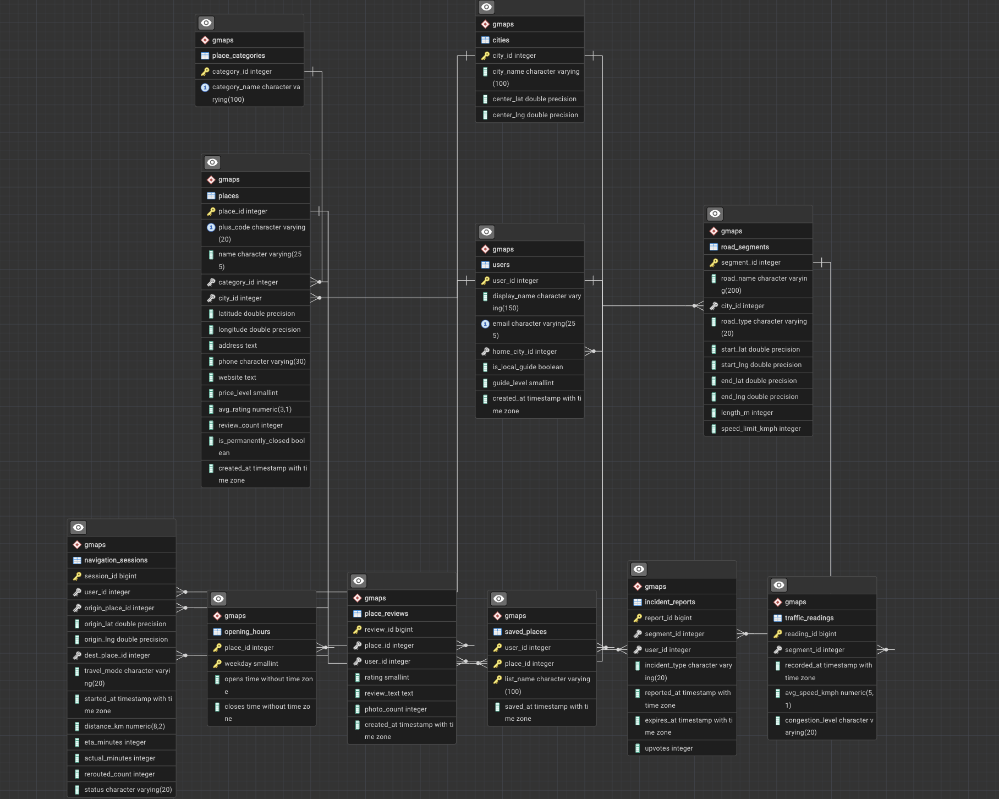
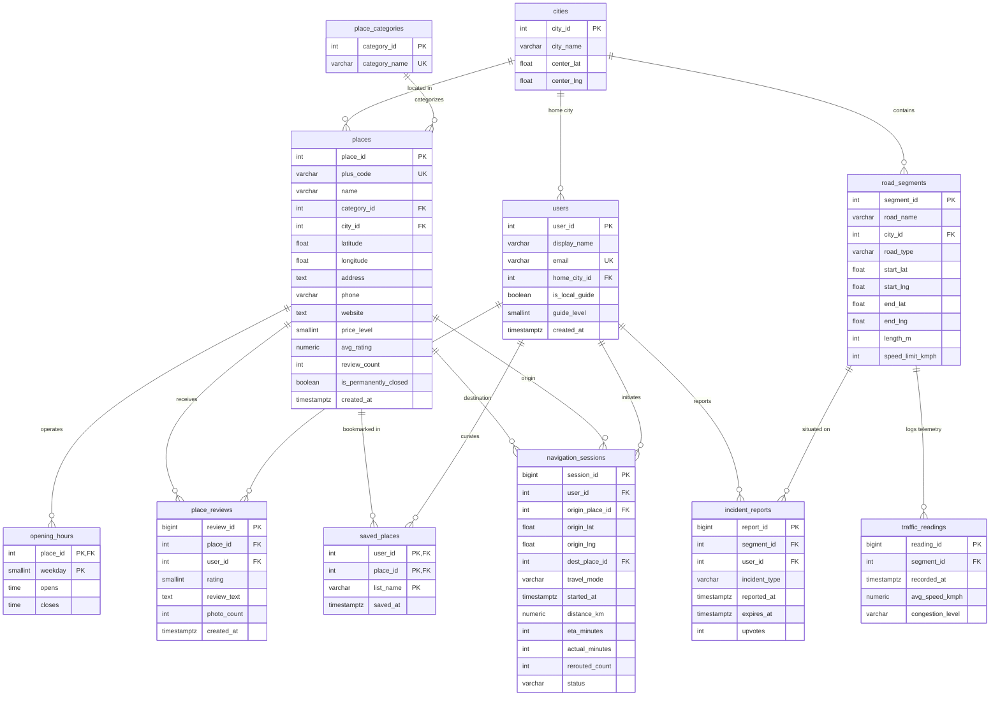

# Schema Design 

## 1. Entity-Relationship (ER) Diagram



### Cardinality Summary:
* **One-to-Many (1:N):**
  * `cities` → `places`: A city has many places; each place belongs to one city.
  * `cities` → `users`: A city has many users living in it; a user has one home city (or NULL).
  * `cities` → `road_segments`: A city has many road segments.
  * `place_categories` → `places`: A category contains many places; a place has one category.
  * `places` → `opening_hours`: A place has up to 7 opening hour entries (one per weekday).
  * `road_segments` → `traffic_readings`: A road segment records many periodic speed readings.
  * `road_segments` → `incident_reports`: A road segment can have multiple reported hazards.
* **Many-to-Many (M:N):**
  * `users` and `places` via `place_reviews`: Users write reviews for places; places receive reviews from multiple users.
  * `users` and `places` via `saved_places`: Users save places to lists; places appear in multiple users' lists.
  * `places` and `navigation_sessions`: Places serve as origins and destinations for navigation sessions.

<details>
<summary><b>Click to view Mermaid specification code</b></summary>


</details>

---

## 2. Data Dictionary

### 2.1 `cities`
| Column | Data Type | Constraints | Description / Why |
|---|---|---|---|
| `city_id` | `INTEGER` | `PRIMARY KEY` | Unique city identifier. |
| `city_name` | `VARCHAR(100)` | `NOT NULL` | Name of the city (e.g. Mumbai, Bengaluru). |
| `center_lat` | `DOUBLE PRECISION` | `NOT NULL, CHECK (-90 to 90)` | Center latitude of city; double precision for coordinates. |
| `center_lng` | `DOUBLE PRECISION` | `NOT NULL, CHECK (-180 to 180)` | Center longitude of city. |

### 2.2 `place_categories`
| Column | Data Type | Constraints | Description / Why |
|---|---|---|---|
| `category_id` | `INTEGER` | `PRIMARY KEY` | Unique category identifier. |
| `category_name` | `VARCHAR(100)` | `NOT NULL, UNIQUE` | Category name (e.g. Restaurant, Hospital). Must be unique. |

### 2.3 `users`
| Column | Data Type | Constraints | Description / Why |
|---|---|---|---|
| `user_id` | `INTEGER` | `PRIMARY KEY` | Unique user identifier. |
| `display_name` | `VARCHAR(150)` | `NOT NULL` | User screen name. |
| `email` | `VARCHAR(255)` | `NOT NULL, UNIQUE` | User email address. Candidate key. |
| `home_city_id` | `INTEGER` | `NULL, FK -> cities ON DELETE SET NULL` | Home city. Null if not provided. `SET NULL` so deleting a city doesn't delete users. |
| `is_local_guide`| `BOOLEAN` | `NOT NULL, DEFAULT FALSE` | True if the user participates as a Local Guide. |
| `guide_level` | `SMALLINT` | `NULL, CHECK (1 to 10 if guide, NULL if not)` | Level tier for Local Guides. NULL for regular users. |
| `created_at` | `TIMESTAMPTZ` | `NOT NULL` | Registration timestamp with timezone (`+05:30`). |

### 2.4 `places`
| Column | Data Type | Constraints | Description / Why |
|---|---|---|---|
| `place_id` | `INTEGER` | `PRIMARY KEY` | Unique place identifier. |
| `plus_code` | `VARCHAR(20)` | `NOT NULL, UNIQUE` | Open Location Code (e.g. `22222222+23`). Natural candidate key. |
| `name` | `VARCHAR(255)` | `NOT NULL` | Place / business name. |
| `category_id` | `INTEGER` | `NOT NULL, FK -> place_categories RESTRICT` | Category ID. `RESTRICT` prevents deleting categories that have places. |
| `city_id` | `INTEGER` | `NOT NULL, FK -> cities RESTRICT` | City ID. `RESTRICT` prevents deleting cities that have places. |
| `latitude` | `DOUBLE PRECISION` | `NOT NULL, CHECK (-90 to 90)` | WGS-84 latitude. |
| `longitude` | `DOUBLE PRECISION` | `NOT NULL, CHECK (-180 to 180)` | WGS-84 longitude. |
| `address` | `TEXT` | `NOT NULL` | Street address. |
| `phone` | `VARCHAR(30)` | `NULL` | Phone number. Null for places that haven't added one. |
| `website` | `TEXT` | `NULL` | Website URL. Null for local shops without a site. |
| `price_level` | `SMALLINT` | `NULL, CHECK (1 to 4)` | Price tier (1 to 4). Null for non-commercial places (parks, hospitals). |
| `avg_rating` | `NUMERIC(3,1)`| `NULL, CHECK (1.0 to 5.0)` | Average rating. NULL if the place has no reviews yet (Assumption 4). |
| `review_count`| `INTEGER` | `NOT NULL, DEFAULT 0` | Total review count. 0 if no reviews yet. |
| `is_permanently_closed` | `BOOLEAN` | `NOT NULL, DEFAULT FALSE` | True if business is shut down. |
| `created_at` | `TIMESTAMPTZ` | `NOT NULL` | Date place was added. |

### 2.5 `opening_hours`
| Column | Data Type | Constraints | Description / Why |
|---|---|---|---|
| `place_id` | `INTEGER` | `NOT NULL, FK -> places CASCADE` | Place reference. `CASCADE` deletes hours if the place is removed. |
| `weekday` | `SMALLINT` | `NOT NULL, CHECK (1 to 7)` | Day of the week (1=Monday .. 7=Sunday). |
| `opens` | `TIME` | `NOT NULL` | Opening time. |
| `closes` | `TIME` | `NOT NULL` | Closing time. Can be earlier than `opens` if open past midnight (Assumption 3). |
| *(Composite PK)* | | `PRIMARY KEY (place_id, weekday)` | A place has one schedule per day of the week. |

### 2.6 `place_reviews`
| Column | Data Type | Constraints | Description / Why |
|---|---|---|---|
| `review_id` | `BIGINT` | `PRIMARY KEY` | Unique review identifier. `BIGINT` used for large table size. |
| `place_id` | `INTEGER` | `NOT NULL, FK -> places CASCADE` | Place being reviewed. |
| `user_id` | `INTEGER` | `NOT NULL, FK -> users CASCADE` | User authoring review. |
| `rating` | `SMALLINT` | `NOT NULL, CHECK (1 to 5)` | Star rating from 1 to 5. |
| `review_text` | `TEXT` | `NULL` | Review comment. Null if user only selected stars without text. |
| `photo_count` | `INTEGER` | `NOT NULL, DEFAULT 0` | Number of uploaded photos. |
| `created_at` | `TIMESTAMPTZ` | `NOT NULL` | Submission timestamp. |
| *(Unique)* | | `UNIQUE (place_id, user_id)` | A user can submit only one review per place. |

### 2.7 `saved_places`
| Column | Data Type | Constraints | Description / Why |
|---|---|---|---|
| `user_id` | `INTEGER` | `NOT NULL, FK -> users CASCADE` | User who saved the place. |
| `place_id` | `INTEGER` | `NOT NULL, FK -> places CASCADE` | Saved place. |
| `list_name` | `VARCHAR(100)` | `NOT NULL, CHECK (list_name IN ('Favourites', 'Travel plans', 'Want to go', 'Starred'))` | Name of the list. |
| `saved_at` | `TIMESTAMPTZ` | `NOT NULL` | Time saved. |
| *(Composite PK)* | | `PRIMARY KEY (user_id, place_id, list_name)` | Users can save the same place into multiple lists (Assumption 5). |

### 2.8 `road_segments`
| Column | Data Type | Constraints | Description / Why |
|---|---|---|---|
| `segment_id` | `INTEGER` | `PRIMARY KEY` | Unique road segment identifier. |
| `road_name` | `VARCHAR(200)` | `NOT NULL` | Name of the road. |
| `city_id` | `INTEGER` | `NOT NULL, FK -> cities RESTRICT` | City where road is located. |
| `road_type` | `VARCHAR(20)` | `NOT NULL, CHECK (road_type IN ('HIGHWAY', 'ARTERIAL', 'LOCAL'))` | Type of road. |
| `start_lat`, `start_lng` | `DOUBLE PRECISION` | `NOT NULL` | Start coordinates of road segment. |
| `end_lat`, `end_lng` | `DOUBLE PRECISION` | `NOT NULL` | End coordinates of road segment. |
| `length_m` | `INTEGER` | `NOT NULL, CHECK (length_m > 0)` | Road length in meters. |
| `speed_limit_kmph` | `INTEGER` | `NOT NULL, CHECK (speed_limit_kmph > 0)` | Speed limit in km/h. |

### 2.9 `traffic_readings`
| Column | Data Type | Constraints | Description / Why |
|---|---|---|---|
| `reading_id` | `BIGINT` | `PRIMARY KEY` | Unique reading ID. `BIGINT` used for high volume (250k+ rows). |
| `segment_id` | `INTEGER` | `NOT NULL, FK -> road_segments CASCADE` | Road segment being monitored. |
| `recorded_at` | `TIMESTAMPTZ` | `NOT NULL` | Timestamp of telemetry reading. |
| `avg_speed_kmph` | `NUMERIC(5,1)` | `NOT NULL, CHECK (avg_speed_kmph >= 0)` | Average vehicle speed. |
| `congestion_level` | `VARCHAR(20)` | `NOT NULL, CHECK (congestion_level IN ('LOW', 'MODERATE', 'HEAVY', 'STANDSTILL'))` | Congestion classification. |

### 2.10 `navigation_sessions`
| Column | Data Type | Constraints | Description / Why |
|---|---|---|---|
| `session_id` | `BIGINT` | `PRIMARY KEY` | Unique session ID. `BIGINT` used for high trip volume (200k+ rows). |
| `user_id` | `INTEGER` | `NULL, FK -> users ON DELETE SET NULL` | Navigating user. NULL for anonymous / guest sessions (Assumption 2). |
| `origin_place_id`| `INTEGER` | `NULL, FK -> places ON DELETE SET NULL` | Origin place. NULL when starting from live GPS coordinates (Assumption 1). |
| `origin_lat`, `origin_lng` | `DOUBLE PRECISION` | `NOT NULL` | Exact starting GPS coordinates. |
| `dest_place_id` | `INTEGER` | `NOT NULL, FK -> places RESTRICT` | Destination place. |
| `travel_mode` | `VARCHAR(20)` | `NOT NULL, CHECK (travel_mode IN ('DRIVE', 'TWO_WHEELER', 'TRANSIT', 'WALK'))` | Mode of travel. |
| `started_at` | `TIMESTAMPTZ` | `NOT NULL` | Trip start time. |
| `distance_km` | `NUMERIC(8,2)` | `NOT NULL, CHECK (distance_km >= 0)` | Route distance in km (Assumption 6). |
| `eta_minutes` | `INTEGER` | `NOT NULL, CHECK (eta_minutes > 0)` | Estimated trip time in minutes. |
| `actual_minutes` | `INTEGER` | `NULL, CHECK (actual_minutes > 0)` | Actual travel time. NULL if trip is cancelled or still in progress. |
| `rerouted_count` | `INTEGER` | `NOT NULL, DEFAULT 0` | Times route was recalculated. |
| `status` | `VARCHAR(20)` | `NOT NULL, CHECK (status IN ('COMPLETED', 'CANCELLED', 'IN_PROGRESS'))` | Status of trip. |

### 2.11 `incident_reports`
| Column | Data Type | Constraints | Description / Why |
|---|---|---|---|
| `report_id` | `BIGINT` | `PRIMARY KEY` | Unique incident ID. |
| `segment_id` | `INTEGER` | `NOT NULL, FK -> road_segments CASCADE` | Road segment where incident occurred. |
| `user_id` | `INTEGER` | `NOT NULL, FK -> users CASCADE` | User who reported the hazard. |
| `incident_type` | `VARCHAR(20)` | `NOT NULL, CHECK (incident_type IN ('ROADWORK', 'BREAKDOWN', 'WATERLOGGING', 'POLICE', 'ACCIDENT', 'CLOSURE'))` | Hazard category. |
| `reported_at` | `TIMESTAMPTZ` | `NOT NULL` | Submission timestamp. |
| `expires_at` | `TIMESTAMPTZ` | `NOT NULL, CHECK (expires_at >= reported_at)` | Expiry timestamp. Must be after report time. |
| `upvotes` | `INTEGER` | `NOT NULL, DEFAULT 0` | Confirmation count from other drivers. |

---

## 3. Functional Dependencies & Normalization

### 3.1 Functional Dependencies by Table

| Table | Candidate Keys | Functional Dependencies (FDs) | Normal Form |
|---|---|---|:---:|
| `cities` | `{city_id}` | `city_id -> city_name, center_lat, center_lng` | **BCNF** |
| `place_categories` | `{category_id}`, `{category_name}` | `category_id -> category_name`<br>`category_name -> category_id` | **BCNF** |
| `users` | `{user_id}`, `{email}` | `user_id -> display_name, email, home_city_id, is_local_guide, guide_level, created_at`<br>`email -> user_id, ...` | **BCNF** |
| `places` | `{place_id}`, `{plus_code}` | `place_id -> plus_code, name, category_id, city_id, latitude, longitude, address, phone, website, price_level, avg_rating, review_count, is_permanently_closed, created_at`<br>`plus_code -> place_id, ...` | **3NF** *(Has derived rating fields)* |
| `opening_hours` | `{(place_id, weekday)}` | `(place_id, weekday) -> opens, closes` | **BCNF** |
| `place_reviews` | `{review_id}`, `{(place_id, user_id)}` | `review_id -> place_id, user_id, rating, review_text, photo_count, created_at`<br>`(place_id, user_id) -> review_id, ...` | **BCNF** |
| `saved_places` | `{(user_id, place_id, list_name)}` | `(user_id, place_id, list_name) -> saved_at` | **BCNF** |
| `road_segments` | `{segment_id}` | `segment_id -> road_name, city_id, road_type, start_lat, start_lng, end_lat, end_lng, length_m, speed_limit_kmph` | **BCNF** |
| `traffic_readings` | `{reading_id}` | `reading_id -> segment_id, recorded_at, avg_speed_kmph, congestion_level` | **3NF** *(Congestion level derived)* |
| `navigation_sessions` | `{session_id}` | `session_id -> user_id, origin_place_id, origin_lat, origin_lng, dest_place_id, travel_mode, started_at, distance_km, eta_minutes, actual_minutes, rerouted_count, status` | **3NF** *(ETA derived)* |
| `incident_reports` | `{report_id}` | `report_id -> segment_id, user_id, incident_type, reported_at, expires_at, upvotes` | **BCNF** |

### 3.2 Normal Form Summary
* **1NF:** Every column stores single atomic values, and each table has a defined primary key.
* **2NF:** For composite-key tables (`opening_hours` and `saved_places`), non-key columns depend on the full composite key, so there are no partial dependencies.
* **3NF / BCNF:** In most tables, every determinant is a superkey. The only tables with derived attributes are `places`, `traffic_readings`, and `navigation_sessions`.

### 3.3 Why We Keep Derived Columns
1. **`places.avg_rating` and `places.review_count`:**
   * These come from `AVG(rating)` and `COUNT(*)` in `place_reviews`.
   * Storing them in `places` lets user search queries quickly sort by top-rated places without recalculating across 90,000+ reviews every time.
2. **`traffic_readings.congestion_level`:**
   * This is determined by vehicle speed relative to the road speed limit.
   * Storing `'LOW'`, `'MODERATE'`, `'HEAVY'`, or `'STANDSTILL'` allows the live traffic map to filter and color roads directly without doing math on every query.
3. **`navigation_sessions.eta_minutes`:**
   * This is the initial predicted duration when the user starts navigation.
   * We must store this value so the routing team can compare `eta_minutes` with `actual_minutes` later to measure prediction accuracy.

---

## 4. Row Count Verification

All 11 CSV files loaded without any errors using `sql/02_load_data.sql`:

| Table Name | Source CSV File | Expected Rows | Ingested Rows | Match? |
|---|---|---:|---:|:---:|
| `cities` | `seed_data/cities.csv` | 10 | 10 | Yes |
| `place_categories` | `seed_data/place_categories.csv` | 12 | 12 | Yes |
| `users` | `seed_data/users.csv` | 40,000 | 40,000 | Yes |
| `places` | `seed_data/places.csv` | 40,042 | 40,042 | Yes |
| `opening_hours` | `seed_data/opening_hours.csv` | 252,266 | 252,266 | Yes |
| `place_reviews` | `seed_data/place_reviews.csv` | 89,998 | 89,998 | Yes |
| `saved_places` | `seed_data/saved_places.csv` | 50,000 | 50,000 | Yes |
| `road_segments` | `seed_data/road_segments.csv` | 2,000 | 2,000 | Yes |
| `traffic_readings` | `seed_data/traffic_readings.csv` | 250,000 | 250,000 | Yes |
| `navigation_sessions` | `seed_data/navigation_sessions.csv` | 200,000 | 200,000 | Yes |
| `incident_reports` | `seed_data/incident_reports.csv` | 12,000 | 12,000 | Yes |
| **Total** | | **894,328** | **894,328** | **100% Loaded** |

---

## 5. Integrity Check Results

We ran 3 simple verification queries on the loaded database to test logical data consistency:

### Check 1: Incident Expiry Check (Chronological Order)
*Question:* Does any hazard report expire before the time it was reported?
```sql
SELECT count(*) AS invalid_incidents
FROM incident_reports
WHERE expires_at < reported_at;
```
*Result:* `0`
*Finding:* A road hazard (like an accident or waterlogging) should always expire after it is reported. A result of 0 confirms all incident timestamps are chronologically valid.

### Check 2: Completed Trip Duration Check
*Question:* If a navigation trip is marked as `COMPLETED`, does it have a valid, positive travel duration?
```sql
SELECT count(*) AS invalid_completed_trips
FROM navigation_sessions
WHERE status = 'COMPLETED' 
  AND (actual_minutes IS NULL OR actual_minutes <= 0);
```
*Result:* `0`
*Finding:* A completed journey cannot take 0 minutes or have a missing (`NULL`) duration. All completed trips have valid positive times.

### Check 3: Local Guide Level Consistency
*Question:* Does any regular user who is not a Local Guide have a `guide_level` assigned?
```sql
SELECT count(*) AS invalid_guides
FROM users
WHERE is_local_guide = FALSE 
  AND guide_level IS NOT NULL;
```
*Result:* `0`
*Finding:* Only users enrolled in the Local Guides program should have a tier level (1 to 10). Regular users have a NULL level, confirming the rule is respected across all 40,000 users.

---

## 6. Data Problems & Edge Cases Found

These findings directly relate to our assumptions from Phase 1:

1. **Composite Key in `saved_places` (Assumption 5):**
   A user can save the same place into different lists (e.g. user `37886` saved place `4088` in both `'Favourites'` and `'Starred'`). Setting the primary key to only `(user_id, place_id)` caused duplicate key errors during `\copy`. The primary key had to be `(user_id, place_id, list_name)`.

2. **Null `origin_place_id` and Anonymous Users (Assumptions 1 & 2):**
   * Around 96% of navigation sessions have `origin_place_id = NULL` because users start navigating from their current GPS pin.
   * Some sessions also have `user_id = NULL` for guest navigation.
   * Because `origin_place_id` contains NULLs, a query using `WHERE place_id NOT IN (SELECT origin_place_id FROM navigation_sessions)` evaluates to UNKNOWN and returns 0 rows due to SQL three-valued logic. Queries must use `NOT EXISTS` or filter `WHERE origin_place_id IS NOT NULL`.

3. **Midnight Closing Times (Assumption 3):**
   Venues open late at night have `closes < opens` (e.g. opens at 18:00, closes at 02:00 next day). A simple `CHECK (opens < closes)` would incorrectly reject valid rows. Queries checking "open now" must use conditional logic to handle times that wrap past midnight.

4. **Places with No Reviews (Assumption 4):**
   Places that haven't received any reviews have `review_count = 0` and `avg_rating = NULL`. Our constraints allow NULL ratings when the review count is 0.
